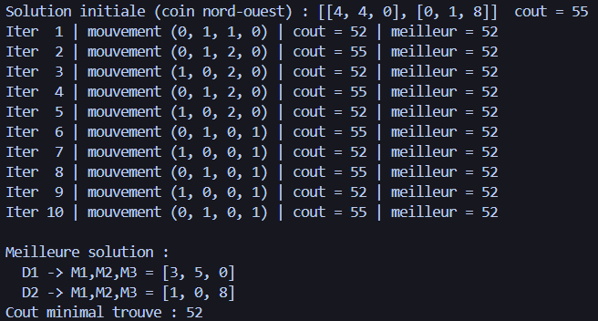
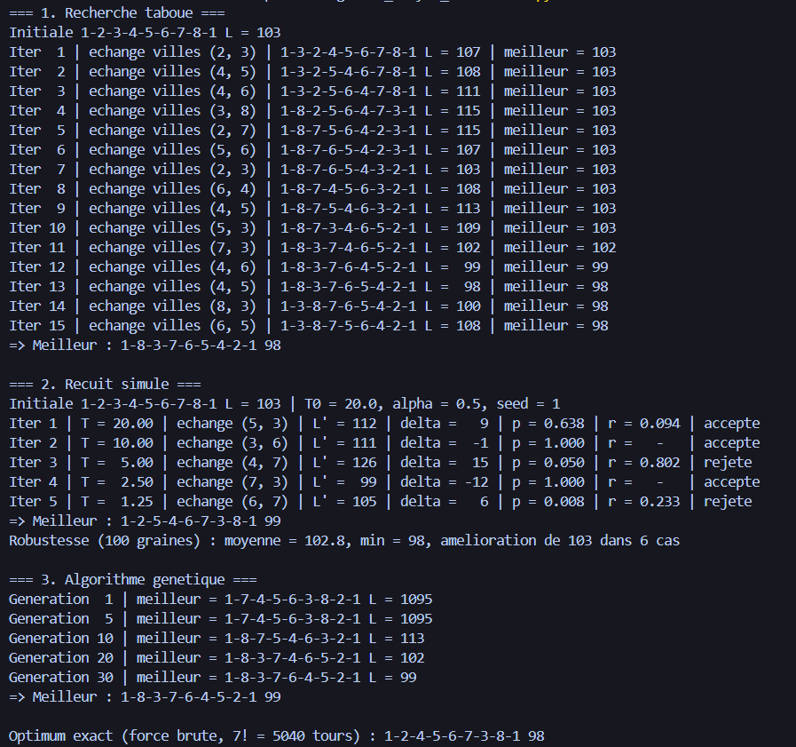
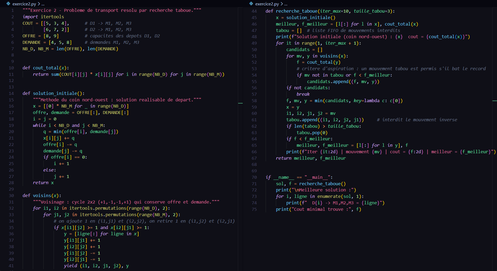
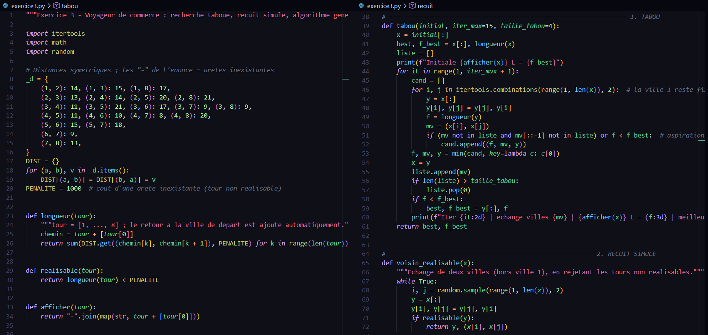
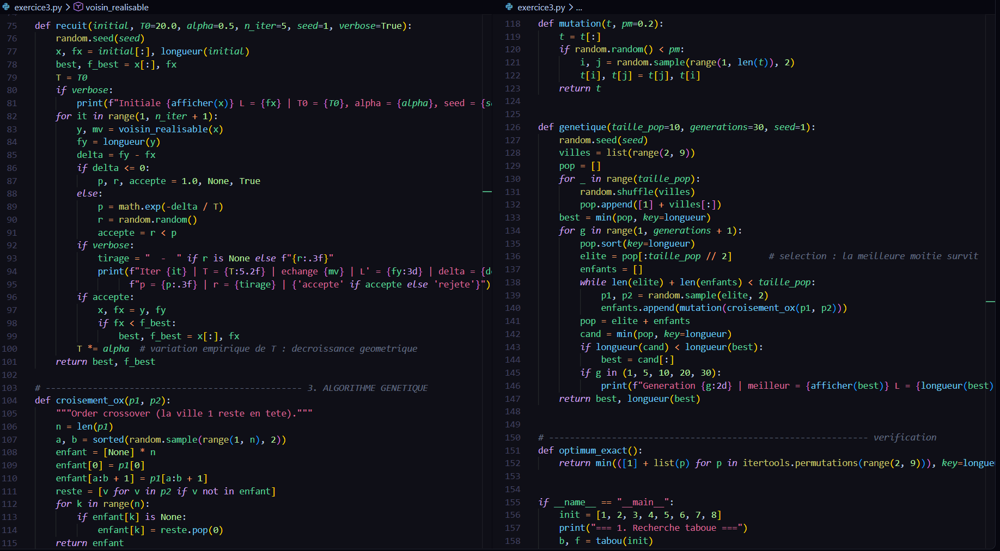
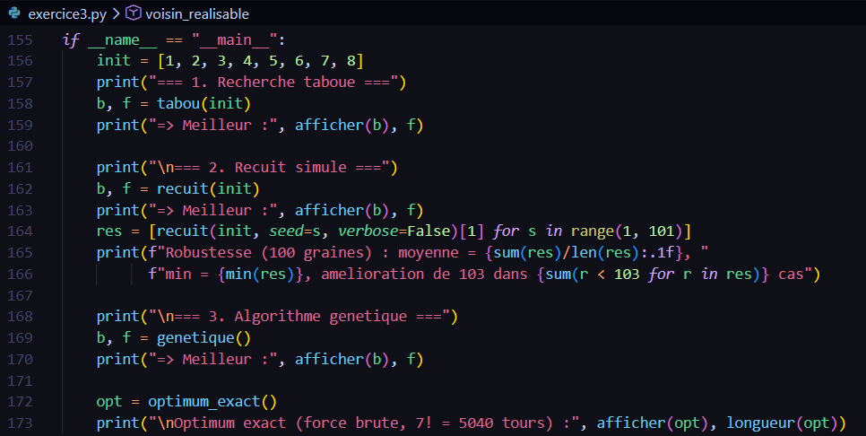

# TD 2 - Métaheuristiques (Faculté des Sciences de Sfax)

Résolution de deux problèmes d'optimisation en Python (aucune bibliothèque externe, Python 3 seulement).

## Contenu

| Fichier | Contenu |
|---|---|
| `exercice2.py` | Exercice 2 : problème de transport (2 dépôts, 3 magasins), **recherche taboue** |
| `exercice3.py` | Exercice 3 : voyageur de commerce (8 villes) avec **recherche taboue**, **recuit simulé** et **algorithme génétique** |
| `compte_rendu_TD.pdf` | Compte rendu : modélisation, paramètres, traces d'exécution, comparaison |

## Exécution

```bash
python exercice2.py
python exercice3.py
```

## Résultats

**Exercice 2** : coût minimal **52** (D1 -> M1, M2, M3 = 3, 5, 0 ; D2 -> 1, 0, 8). Solution initiale par coin nord-ouest (coût 55).
*Capture d'écran de l'exécution (Exercice 2) :*



**Exercice 3** (solution initiale 1-2-3-4-5-6-7-8-1, longueur 103) :

| Méthode | Meilleur tour | Longueur |
|---|---|---|
| Recherche taboue (15 itérations) | 1-8-3-7-6-5-4-2-1 | 98 |
| Recuit simulé (5 itérations, T0 = 20, alpha = 0,5) | 1-2-5-4-6-7-3-8-1 | 99 |
| Algorithme génétique (10 individus, 30 générations) | 1-8-3-7-6-4-5-2-1 | 99 |
| Force brute (vérification) | 1-2-4-5-6-7-3-8-1 | 98 |

*Capture d'écran de l'exécution (Exercice 3) :*


Remarque : avec seulement 5 itérations, le recuit simulé dépend fortement de la graine aléatoire (moyenne 102,8 sur 100 graines).

## Hypothèses

- Exercice 2 : la colonne « Dépôt » est le stock de chaque dépôt (8 et 9 containers).
- Exercice 3 : un tiret dans le tableau signifie « pas d'arête » (pénalité de 1000), distances symétriques.

## Captures du code

### Exercice 2


### Exercice 3


